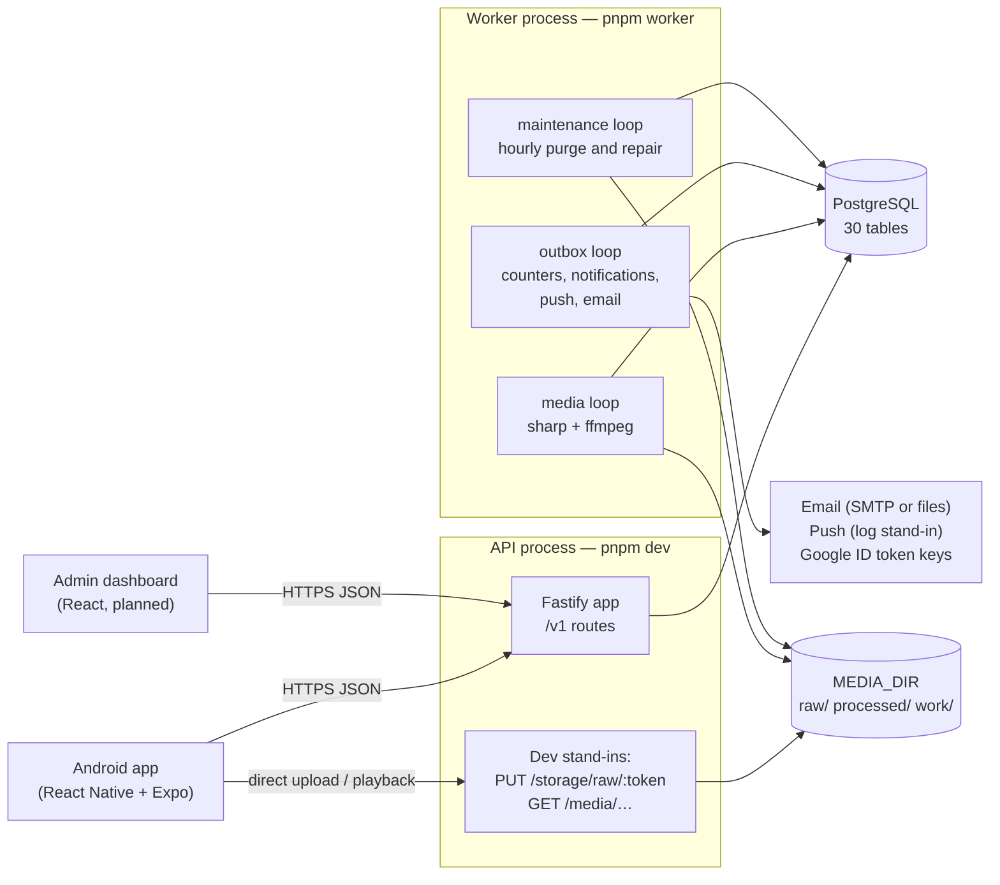
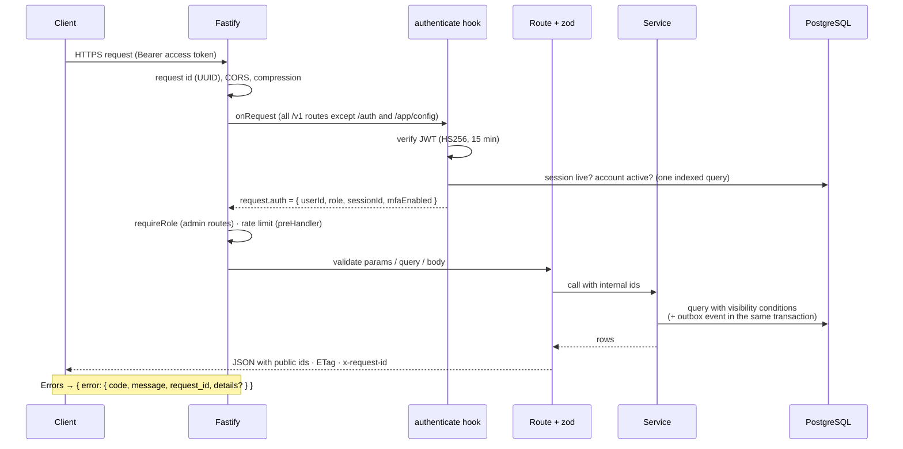
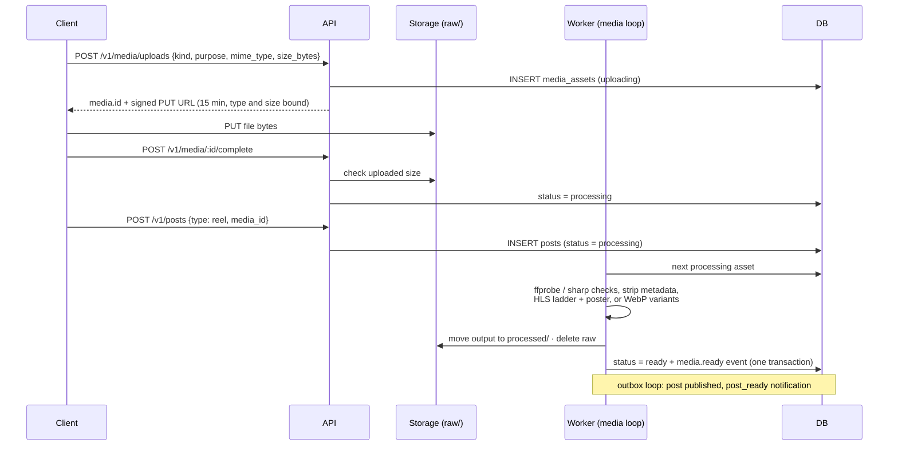

# Backend architecture

Status as of Nov 22, 2026 (Prototype 2 backend, `apps/api`).

Related: [Database architecture](database-architecture.md) · [API reference and setup](../../apps/api/README.md) · [Implementation notes and decisions](../prototype-2-implementation-notes.md)

## Contents

1. [System overview](#1-system-overview)
2. [Tech stack](#2-tech-stack)
3. [Code layout and layering](#3-code-layout-and-layering)
4. [Request lifecycle](#4-request-lifecycle)
5. [Security model](#5-security-model)
6. [Outbox events](#6-outbox-events)
7. [Background worker](#7-background-worker)
8. [Media pipeline](#8-media-pipeline)
9. [Search](#9-search)
10. [Outside services (providers)](#10-outside-services-providers)
11. [Configuration](#11-configuration)
12. [Testing](#12-testing)
13. [What is not built yet](#13-what-is-not-built-yet)

---

## 1. System overview

There are two Node.js processes, both talking to one PostgreSQL database. Postgres is also the job queue; there is no Redis yet.



The design rules:

- **The request path stays fast.** Slow or failure-prone work (transcoding, notifications, push, email, counters) runs in the worker. A request writes its change plus an outbox event in one transaction and returns.
- **File bytes never pass through API route handlers.** Clients upload to a signed storage URL and play media from signed or public storage URLs. In development the API process serves those URLs as a stand-in for S3/R2 and a CDN.
- **Every outside dependency sits behind an interface** (storage, email, push, Google) with a local implementation, so the whole system runs on one machine with no accounts.

## 2. Tech stack

| Concern | Choice |
| --- | --- |
| Runtime | Node.js 22+, TypeScript (ESM), run with `tsx` |
| HTTP framework | Fastify 5 |
| Validation | zod 4 through `fastify-type-provider-zod` (request schemas) |
| Database access | Kysely (typed query builder) + `pg`; types generated by `kysely-codegen` |
| Migrations | node-pg-migrate (SQL files) |
| Auth | `@fastify/jwt` (HS256 access tokens), Argon2id (`argon2`), `jose` (Google ID tokens), in-house TOTP (RFC 6238) |
| HTTP plugins | `@fastify/rate-limit`, `@fastify/cors`, `@fastify/compress`, `@fastify/etag`, `@fastify/static` |
| Media | `sharp` (images), FFmpeg / ffprobe (video, HLS) |
| Email | `nodemailer` (SMTP), or files in `.dev-mail/` |
| Logging | pino (Fastify's logger), with token redaction |
| Tests | Vitest + `fastify.inject` |
| Monorepo | pnpm workspaces: `apps/api` and `packages/shared` (constants and enum lists shared with the apps) |

## 3. Code layout and layering

```
apps/api/src/
  server.ts            API entry point: buildApp(), listen, graceful shutdown
  worker.ts            Worker entry point: advisory lock, three loops, graceful shutdown
  app.ts               Plugin registration, security headers, route tree
  config/env.ts        Environment variables, validated with zod at startup
  db/
    index.ts           Kysely instance (pool with statement timeout)
    types.ts           Generated table types
    visibility.ts      SQL conditions for blocks, privacy, drafts, deleted rows
    search.ts          Full-text and trigram conditions (match the indexes)
    errors.ts          Postgres error codes
  lib/                 Cross-cutting helpers
    auth.ts            authenticate / requireRole hooks, AuthContext
    crypto.ts          HKDF-derived keys, signed tokens, AES-GCM, token hashing
    pagination.ts      Keyset pagination with encrypted cursors
    outbox.ts          emit() / emitSearchSync(): event catalogue and writer
    audit.ts           audit() writer for admin and security actions
    storage.ts         Storage interface + LocalDiskStorage
    rate-limits.ts     perIp() / perUser() route options
    errors.ts, error-handler.ts, validation.ts, totp.ts
  providers/index.ts   Email, push, Google sign-in (interfaces + implementations)
  modules/<area>/
    <area>.routes.ts   HTTP: path, zod schemas, rate limits, role hooks, response mapping
    <area>.service.ts  Queries and business rules; takes a Db (pool or transaction)
  worker/
    media.ts           Image and video processing
    outbox.ts          One handler per event type
    notify.ts          Creates notification rows and returns push side effects
    maintenance.ts     Purges, counter repair, clean-up
  scripts/seed.ts      First admin + starter content
```

**Modules:** `auth`, `users`, `posts`, `comments`, `media`, `learn`, `practice`, `research`, `notifications`, `search`, `reports`, `app` (app config, deep links) and `admin` (content, learn, practice, research, moderation, staff).

**Layering rules:**

- Routes do HTTP only: parse with zod, call a service, map rows to the public shape (public UUIDs, never internal ids).
- Services own the SQL and the rules. They accept a `Db`, so the same function works on the pool or inside a transaction.
- Every query that returns user or team content builds its `WHERE` clause from [`db/visibility.ts`](../../apps/api/src/db/visibility.ts). The privacy rules exist only there.
- Writes that need follow-up work call `emit()` inside the same transaction.

## 4. Request lifecycle



**Route tree** ([`app.ts`](../../apps/api/src/app.ts)):

| Prefix | Auth | Contents |
| --- | --- | --- |
| `/health` | none | Database check |
| `/storage/raw/:token`, `/media/…` | signed token in the path | Development stand-ins for presigned uploads and the CDN |
| `/.well-known/assetlinks.json`, `/p/:id`, … | none | Android App Links and share-link fallback |
| `/v1/app/config` | none | Minimum app versions |
| `/v1/auth/*` | none (rate limited per IP) | Sign-up, login, MFA, Google, refresh, verification, password reset |
| `/v1/*` (everything else) | `authenticate` | Account, users, media, posts, comments, learn, practice, research, notifications, search, reports |
| `/v1/admin/*` | `authenticate` + `requireRole` + 2FA | Moderation (moderator+); content and staff management (admin) |

Endpoint details: [API reference](../../apps/api/README.md#endpoints-all-under-v1).

**API conventions:** everything under `/v1`; ids are UUIDs and topics and fields use slugs; paginated lists return `{ items, next_cursor }` with keyset pagination on `(created_at, id)` and an AES-GCM-encrypted cursor; something the caller may not see returns **404**, not 403.

## 5. Security model

### 5.1 Keys

One root secret, `APP_SECRET`. A separate 32-byte key is derived with HKDF-SHA256 for each purpose (`jwt`, `cursor`, `upload`, `media`, `mfa`, `totp`), so a key leaked from one purpose can't forge another. Rotating `APP_SECRET` signs everyone out and breaks existing media links.

### 5.2 Tokens and sessions

```mermaid
sequenceDiagram
    participant C as Client
    participant API
    participant DB

    C->>API: POST /v1/auth/login {login, password, platform}
    API->>DB: find user · argon2 verify (dummy hash if no user)
    alt 2FA enabled
        API-->>C: { mfa_required, mfa_token }
        C->>API: POST /v1/auth/login/mfa {mfa_token, code}
    end
    API->>DB: INSERT sessions (hash of refresh secret)
    API-->>C: access_token (JWT: sub, sid; 15 min) + refresh_token (sid.secret; 30 days)
    C->>API: POST /v1/auth/refresh {refresh_token}
    API->>DB: compare-and-swap refresh_token_hash
    alt hash matches
        API-->>C: new token pair (old refresh token no longer works)
    else old token reused
        API->>DB: revoke the session
        API-->>C: 401 REFRESH_TOKEN_REUSED
    end
```

- Access tokens contain **public ids only** (`sub` = user, `sid` = session).
- Each request checks the session and account in the database, so signing out a device, suspension and deletion take effect immediately.
- Password reset revokes every session. Users can list their devices and sign one out.
- Google sign-in verifies the ID token against Google's keys (issuer, audience = `GOOGLE_CLIENT_IDS`, expiry). A verified Google email links to an existing account with that email.
- Two-factor sign-in uses TOTP. The secret is stored AES-256-GCM encrypted, and staff routes require it (`403 MFA_REQUIRED`).

### 5.3 Abuse protection

| Control | Where |
| --- | --- |
| Per-IP limits on sign-in routes, per-user limits on posting, commenting and other writes | `@fastify/rate-limit`, [`lib/rate-limits.ts`](../../apps/api/src/lib/rate-limits.ts); in memory per process |
| Per-account delays that grow with failed sign-ins | [`auth/login-throttle.ts`](../../apps/api/src/modules/auth/login-throttle.ts); in memory |
| Constant-time login: argon2 always runs | `auth.service.ts` |
| Account enumeration: login errors look the same, password reset always returns 202 | `auth.service.ts` |
| Upload limits (type and size) set in the signed upload URL | `media.service.ts` |

### 5.4 Data exposure

- Object-level visibility in one layer ([`db/visibility.ts`](../../apps/api/src/db/visibility.ts)): blocks apply both ways; private accounts only to accepted followers; drafts and archived content to staff only; suspended, deleted and soft-deleted rows hidden.
- Search never returns private posts, drafts or blocked users.
- Post media uses **signed URLs** (about 24–48 h for public accounts, 1–2 h for private ones). Avatars, learn media and paper figures are public and immutable under unguessable UUID keys.
- Logs: request ids are generated by the server (client ids ignored); tokens in `/storage/raw/…` and `/media/s/…` paths are redacted; no emails, passwords or bodies are logged.
- Headers: `x-request-id`, `x-content-type-options: nosniff`, and HSTS in production. `trustProxy` is on in production (behind Caddy).
- Every admin action writes an `audit_log` row in the same transaction ([`lib/audit.ts`](../../apps/api/src/lib/audit.ts)).

## 6. Outbox events

A change and its event are committed together ([`lib/outbox.ts`](../../apps/api/src/lib/outbox.ts)), so an event exists exactly when the change committed. The worker handles them in `id` order ([`worker/outbox.ts`](../../apps/api/src/worker/outbox.ts)).

| Event | Written by | Worker does |
| --- | --- | --- |
| `follow.created` | follow a user | `follow` or `follow_request` notification + push |
| `post.liked` | like | Recounts counters; `like` notification |
| `post.unliked` | unlike | Recounts counters |
| `comment.created` | comment / reply | Recounts counters; `reply` to the parent's author, `comment` to the post's author |
| `comment.deleted` | delete comment, moderation | Recounts counters |
| `media.ready` | media worker | Publishes posts waiting on this asset (`post_ready` notification), or sets the avatar and deletes older avatar files |
| `email.verify` | sign-up, resend | Creates a 24 h code (hash stored) and emails the link |
| `email.password_reset` | reset request | Creates a 1 h code and emails the link |
| `search.sync` | changes to users, posts, topics, learn items, courses, papers | Nothing yet; kept for the future Elasticsearch indexer |

**Delivery guarantees**

- An event's database work and its `processed_at` mark commit in **one transaction**. Notifications and counters are therefore applied exactly once.
- Push and email run **after** that commit, best effort: a failure is logged, not retried.
- Counters are **recounted**, never incremented, so handling an event twice can't make them drift.
- A failing event is retried on later batches. After 10 attempts it stays unprocessed for inspection.

## 7. Background worker

[`src/worker.ts`](../../apps/api/src/worker.ts) is a separate process (`pnpm worker`).

| Loop | Interval when idle | Work |
| --- | --- | --- |
| media | 2 s | Takes the oldest `media_assets` row with `status = 'processing'` and processes it (§8). It has its own loop so a long transcode doesn't delay notifications |
| outbox | 1 s | Up to 50 pending events per batch (§6) |
| maintenance | 1 h | Purge deleted accounts and posts after 30 days, repair counters, delete abandoned uploads, old sessions, used codes and old events ([database §7](database-architecture.md#7-data-lifecycle-and-retention)) |

- **Only one worker can run.** It takes a Postgres advisory lock at start-up, and a second copy exits.
- **Graceful shutdown.** SIGINT or SIGTERM lets the current work finish, then releases the lock and closes the pool.
- A loop error is logged and the loop carries on.

## 8. Media pipeline



| Kind | Output |
| --- | --- |
| Image (JPEG, PNG, WebP; up to 15 MB) | WebP variants: 320 (thumbnail), 1080 (`url`), 2048 (`full_url`); metadata such as GPS removed |
| Video (MP4, MOV, WebM; up to 150 MB, or 1 GB for learn videos) | HLS ladder by the short side (360/540/720/1080, never upscaled), H.264 + AAC, master playlist + poster. Reels over 90 s and learn videos over 20 min fail |

Storage layout under `MEDIA_DIR`: `raw/` (private originals), `processed/public/<purpose>/<uuid>/` (unsigned), `processed/posts/<uuid>/` (signed only), and `work/` (worker scratch space). A failed asset is final; the client uploads again.

The `Storage` interface ([`lib/storage.ts`](../../apps/api/src/lib/storage.ts)) has `createUploadUrl`, `rawSize`, `openRaw`, `deleteRaw`, `putProcessed`, `deleteProcessed`, `publicUrl` and `signedUrl`. Moving to S3/R2 plus a CDN means writing an `S3Storage` class; the database stores keys, not URLs.

## 9. Search

Search runs on Postgres for now ([`modules/search`](../../apps/api/src/modules/search/), [`db/search.ts`](../../apps/api/src/db/search.ts)):

- **Users and topics:** `pg_trgm` similarity (`%`) or a plain substring match, ranked by `similarity()`.
- **Posts, learn items, courses and papers:** `websearch_to_tsquery('english', q)` against GIN `tsvector` indexes.
- `GET /v1/search` returns results grouped by type, with the same visibility rules as the rest of the API. `GET /v1/search/suggest` gives autocomplete from 2 characters.
- `GET /v1/papers/:id/related` ranks papers by shared "Learn first" topics, then by field.

## 10. Outside services (providers)

[`src/providers/index.ts`](../../apps/api/src/providers/index.ts). Tests replace these with fakes.

| Provider | Interface | Now | Later |
| --- | --- | --- | --- |
| Email | `EmailSender` | SMTP when `SMTP_URL` is set (e.g. the Hostinger mailbox), otherwise text files in `DEV_MAIL_DIR` | — |
| Push | `PushSender` | Writes to `.dev-mail/push.log` (never logs device tokens) | `FcmPush` with `firebase-admin` |
| Google sign-in | `GoogleVerifier` | `jose` against Google's public keys | Add an Apple verifier for iOS |
| Storage | `Storage` | `LocalDiskStorage` | `S3Storage` + CDN, or a managed video provider |

## 11. Configuration

All variables are validated at start-up ([`config/env.ts`](../../apps/api/src/config/env.ts)); see [`.env.example`](../../apps/api/.env.example) for defaults and comments.

| Group | Variables |
| --- | --- |
| Server | `NODE_ENV`, `HOST`, `PORT`, `PUBLIC_URL`, `CORS_ORIGINS` |
| Database | `DATABASE_URL`, `TEST_DATABASE_URL`, `DB_STATEMENT_TIMEOUT_MS` |
| Secrets and tokens | `APP_SECRET`, `ACCESS_TOKEN_TTL_SECONDS` (900), `REFRESH_TOKEN_TTL_DAYS` (30) |
| Sign-in | `GOOGLE_CLIENT_IDS` |
| Media | `MEDIA_DIR`, `FFMPEG_PATH`, `FFPROBE_PATH` |
| Email | `SMTP_URL`, `EMAIL_FROM`, `DEV_MAIL_DIR` |
| Rules | `ACCOUNT_PURGE_DAYS` (30), `APP_TIMEZONE` (Asia/Dhaka, for practice streaks) |
| App | `MIN_APP_VERSION_ANDROID`, `MIN_APP_VERSION_IOS`, `ANDROID_PACKAGE_NAME`, `ANDROID_CERT_FINGERPRINTS` |
| Seed | `SEED_ADMIN_EMAIL`, `SEED_ADMIN_USERNAME`, `SEED_ADMIN_PASSWORD` |

## 12. Testing

- `pnpm test` runs Vitest against `doshomik_test`, which the global setup creates, wipes and migrates.
- Tests call routes through `fastify.inject` (no network) and run worker functions in-process, including the real sharp and FFmpeg pipeline.
- Suites: `auth`, `account`, `social`, `content`, `media` (34 tests).
- Rate limiting is switched off in tests; providers are replaced with fakes.

## 13. What is not built yet

Full reasons and step-by-step plans: [implementation notes §3–5](../prototype-2-implementation-notes.md#3-deferred-work-install-later).

| Item | Effect today |
| --- | --- |
| Redis | Rate limits and sign-in delays are in memory per process; no feed or profile caches; reels are newest-first, not ranked |
| Several workers | Blocked by the advisory lock until lease columns exist |
| S3/R2 + CDN, resumable uploads | Local disk with a single-PUT upload stand-in |
| Elasticsearch / semantic search | Postgres full-text and trigram search |
| Firebase Cloud Messaging | Push is logged, not sent |
| OpenAPI spec, response schemas | Only requests are validated |
| Monitoring, PgBouncer, separate DB roles, backups, secrets manager | Deployment work |
| Docker Compose, Caddy, admin dashboard UI | Not part of the local prototype |
| 2FA recovery codes, Apple sign-in, Play Integrity, Bangla notification text, account restore, change username | Product and hardening follow-ups |
