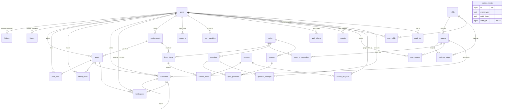

# Database architecture

Status as of Nov 22, 2026 (Prototype 2 backend). Source of truth: the SQL files in [`apps/api/migrations/`](../../apps/api/migrations/). Generated TypeScript types: [`apps/api/src/db/types.ts`](../../apps/api/src/db/types.ts).

Related: [Backend architecture](backend-architecture.md) · [Implementation notes and decisions](../prototype-2-implementation-notes.md) · [API reference](../../apps/api/README.md)

## Contents

1. [Overview](#1-overview)
2. [Conventions](#2-conventions)
3. [Entity–relationship diagram](#3-entityrelationship-diagram)
4. [Tables by domain](#4-tables-by-domain)
5. [Indexes](#5-indexes)
6. [Integrity rules worth knowing](#6-integrity-rules-worth-knowing)
7. [Data lifecycle and retention](#7-data-lifecycle-and-retention)
8. [Migrations](#8-migrations)
9. [Known gaps and planned changes](#9-known-gaps-and-planned-changes)

---

## 1. Overview

| Item | Value |
| --- | --- |
| Engine | PostgreSQL 16+ (works on 13+; `gen_random_uuid()` is built in) |
| Extensions | `pg_trgm` (fuzzy search on usernames and topic names) |
| Tables | 30 |
| Query layer | Kysely (typed SQL builder), `pg` driver, one connection pool per process |
| Migrations | node-pg-migrate, plain SQL files, each run in its own transaction |
| Statement timeout | `DB_STATEMENT_TIMEOUT_MS` (default 5000 ms) on every pooled connection |
| Databases | `doshomik` (development), `doshomik_test` (wiped and migrated by the test run) |

There is no Redis, Elasticsearch or separate queue. Postgres also serves as:

- the **job queue**: `outbox_events`, and `media_assets` rows with `status = 'processing'`;
- the **search engine**: `tsvector` GIN and trigram indexes;
- the **audit store**: `audit_log`.

## 2. Conventions

| Convention | Detail |
| --- | --- |
| Internal keys | `id bigint GENERATED ALWAYS AS IDENTITY`. Used for joins only and **never sent to clients**. |
| Public keys | `public_id uuid DEFAULT gen_random_uuid() UNIQUE` on every row a client can name: users, posts, comments, notifications, papers, courses, learn items, questions, quizzes, media assets and sessions. |
| Slugs | `topics.slug` and `fields.slug` (`NOT NULL UNIQUE`) name those rows in URLs. |
| Enums | `text` columns with `CHECK (... IN (...))`, not Postgres enum types. They are easier to change in a migration. The same lists are in [`packages/shared/src/index.ts`](../../packages/shared/src/index.ts), so change both together. |
| Timestamps | `timestamptz`. `created_at DEFAULT now()` everywhere; `updated_at` on mutable rows, set by the application, not by triggers. |
| Soft delete | `deleted_at` on `users`, `posts` and `comments`. Rows are hidden at once and purged later (§7). |
| Publishing workflow | Team content (`papers`, `courses`, `learn_items`, `questions`, `quizzes`) has `status` `draft` → `published` → `archived`. Most also have `published_at`, `created_by` and `updated_by`. |
| Stored counters | `posts.like_count` and `posts.comment_count`, recomputed by the worker (never incremented) and repaired every hour. |
| Storage keys, not URLs | `media_assets` stores `raw_key`, `playback_key` and `thumbnail_key`. URLs are built at read time, so changing storage provider changes no data. |
| Join tables | Composite primary keys, e.g. `follows (follower_id, following_id)`. |
| Ordered children | `position smallint` in the primary key (`course_items`, `roadmap_steps`, `quiz_questions`), made `DEFERRABLE INITIALLY DEFERRED` so a whole list can be reordered in one transaction. |
| Polymorphic references | `reports.target_id`, `outbox_events.entity_id` and `audit_log.entity_id` have **no foreign key** on purpose: these rows must outlive their targets. |

## 3. Entity–relationship diagram

Keys and relationships only; columns are listed in §4. `||--o{` means one-to-many.

Not shown: `created_by` and `updated_by` on team content, and `reports.target_id` (polymorphic, no FK).

## 4. Tables by domain

Columns are listed as they are **after all four migrations**. PK = primary key, FK = foreign key, U = unique.

### 4.1 Accounts and authentication

**`users`**: one row per account.

| Column | Type | Notes |
| --- | --- | --- |
| id | bigint PK | |
| public_id | uuid U | Exposed as `id` in the API |
| username | text U | Also unique on `lower(username)`; pattern `^[a-z0-9_.]{3,30}$` (enforced in the app) |
| email | text U | Also unique on `lower(email)` |
| password_hash | text, nullable | Argon2id. NULL for Google-only accounts |
| display_name, bio, avatar_url | text | `avatar_url` is set by the worker when an avatar upload is ready |
| role | text | `user` · `moderator` · `admin` |
| status | text | `active` · `suspended` · `deleted` |
| is_private | boolean | Private accounts need accepted follow requests |
| email_verified_at | timestamptz | |
| totp_secret | text | AES-256-GCM encrypted by the API |
| totp_enabled_at | timestamptz | Two-factor sign-in; required for staff routes |
| created_at, updated_at, deleted_at | timestamptz | `deleted_at` starts the 30-day purge clock |

**`sessions`**: one row per signed-in device.

| Column | Type | Notes |
| --- | --- | --- |
| id | bigint PK | |
| public_id | uuid U | The `sid` claim in access tokens; part of the refresh token |
| user_id | FK → users, cascade | |
| refresh_token_hash | text U | SHA-256 of the secret; replaced on every refresh |
| platform | text | `android` · `ios` · `web` |
| app_version, push_token | text | `push_token` is the device's FCM token |
| created_at, last_used_at, expires_at, revoked_at | timestamptz | Sliding 30-day expiry |

**`auth_identities`**: outside sign-in links. PK `(provider, provider_subject)`; `provider` is `google` or `apple`; `user_id` FK → users, cascade.

**`auth_tokens`**: one-time email codes. `purpose` is `verify_email` (24 h) or `reset_password` (1 h); `token_hash` U (the plain code is only in the email); `expires_at`, `used_at`.

### 4.2 Social graph and safety

| Table | Key | Columns | Notes |
| --- | --- | --- | --- |
| `follows` | PK (follower_id, following_id) | status `accepted` · `pending`, created_at | `CHECK follower_id <> following_id`. `pending` = a request to a private account |
| `blocks` | PK (blocker_id, blocked_id) | created_at | Applies both ways in every visibility check; blocking also ends follows |
| `reports` | id PK | reporter_id, target_type `user` · `post` · `comment`, target_id (no FK), reason, details, status `open` · `actioned` · `dismissed`, reviewed_by, reviewed_at | Reasons: `spam`, `harassment`, `nudity`, `violence`, `misinformation`, `other` |

### 4.3 Media

**`media_assets`**: every uploaded image or video, whatever it is used for.

| Column | Type | Notes |
| --- | --- | --- |
| id, public_id | bigint PK, uuid U | |
| owner_id | FK → users, set null | |
| kind | text | `image` · `video` |
| purpose | text | `post` · `avatar` · `learn` · `paper_figure` |
| status | text | `uploading` → `processing` → `ready` or `failed` |
| provider, provider_asset_id | text | `self` (FFmpeg worker), `legacy` (Prototype 1 files); later a managed provider |
| raw_key | text | Original upload in private raw storage; deleted after processing |
| playback_key | text | HLS master playlist (video) or base key of the WebP variants (image) |
| thumbnail_key | text | Poster frame or small image |
| mime_type, size_bytes, width, height, duration_ms | | `duration_ms` is measured by the worker, never taken from the client |
| error | text | Message shown to the user when `failed` |
| created_at, updated_at | timestamptz | |

### 4.4 Posts, comments and notifications

**`posts`**

| Column | Type | Notes |
| --- | --- | --- |
| id, public_id | bigint PK, uuid U | |
| user_id | FK → users, cascade | |
| type | text | `text` · `image` · `reel` |
| caption | text | Required for `text` posts |
| media_id | FK → media_assets | Required unless `type = 'text'` |
| status | text | `processing` (media not ready) · `published` · `removed` (by a moderator) |
| like_count, comment_count | integer | Stored counters (§2) |
| created_at, updated_at, deleted_at | timestamptz | |

| Table | Key | Notes |
| --- | --- | --- |
| `post_likes` | PK (user_id, post_id) | |
| `saved_posts` | PK (user_id, post_id) | |
| `comments` | id PK, public_id U | Attached to **exactly one** of `post_id` or `paper_id` (CHECK). `parent_id` → comments for replies. `user_id` is nullable with `ON DELETE SET NULL`, so threads survive a purged account. `deleted_at` leaves a `[deleted]` placeholder |
| `notifications` | id PK, public_id U | `user_id` receives it, `actor_id` caused it. Types: `follow`, `follow_request`, `like`, `comment`, `reply`, `post_ready`. Optional `post_id` and `comment_id`. `is_read` |

### 4.5 Learn

| Table | Key | Columns / notes |
| --- | --- | --- |
| `topics` | id PK, name U, slug U | `summary`, shown in "Learn first" when a topic has no learn items yet |
| `learn_items` | id PK, public_id U | `topic_id` (set null), `title`, `kind` `video` · `image` · `text`, `body`, `duration_seconds`, `media_url` (outside link) **or** `media_id` (uploaded media) unless `kind = 'text'`, plus the publishing columns |
| `courses` | id PK, public_id U | `title`, `description`, `thumbnail_url`, `external_url` (a free outside course has no items), plus the publishing columns |
| `course_items` | PK (course_id, position) deferrable; U (course_id, item_id) | Ordered steps of a course |
| `course_progress` | PK (user_id, course_id) | `last_position`, `completed_at` |

### 4.6 Practice

| Table | Key | Columns / notes |
| --- | --- | --- |
| `questions` | id PK, public_id U | `topic_id` (cascade), `kind` `mcq` · `short`, `prompt`, `options text[]` (≥ 2 for MCQ), `answer`, `explanation`, plus the publishing columns. No `created_at` (inherited from Prototype 1) |
| `question_attempts` | id PK | `user_id`, `question_id`, `answer`, `is_correct`, `created_at`. Powers history, accuracy per topic and streak days (`APP_TIMEZONE`) |
| `quizzes` | id PK, public_id U | `title`, `topic_id`, `status`, `created_by` (no `published_at` or `updated_by`) |
| `quiz_questions` | PK (quiz_id, position) deferrable; U (quiz_id, question_id) | |

### 4.7 Research

| Table | Key | Columns / notes |
| --- | --- | --- |
| `fields` | id PK, name U, slug U | `description` |
| `papers` | id PK, public_id U | `field_id`, `title`, `authors`, `year`, `paper_url`, `research_questions text[]`, `main_idea`, `data_source`, `method_steps text[]` (in order), `results`, `figures jsonb` (`[{url, caption}]`), `limitations`, `evaluation`, plus the publishing columns |
| `paper_prerequisites` | PK (paper_id, topic_id) | "Learn first" topics, with `position` |
| `roadmap_steps` | PK (field_id, position) deferrable; U (field_id, paper_id) | One starting roadmap per field; `note` explains the step |
| `user_papers` | PK (user_id, paper_id) | Reading tracker: `saved` · `reading` · `completed` |
| `user_fields` | PK (user_id, field_id) | Interests picked at onboarding |

### 4.8 System

| Table | Purpose | Notes |
| --- | --- | --- |
| `outbox_events` | Work for the background worker, written **in the same transaction** as the change | `event_type`, `entity_type`, `entity_id`, `payload jsonb`, `attempts`, `processed_at`. Event types are listed in [backend architecture §6](backend-architecture.md#6-outbox-events) |
| `audit_log` | Every admin and security action | `actor_id` (set null), `action` (e.g. `paper.publish`, `user.suspend`, `user.purge`), `entity_type`, `entity_id`, `changes jsonb`, `ip inet` |

## 5. Indexes

Besides primary keys and unique constraints:

| Purpose | Index |
| --- | --- |
| Profile pages and home feed (keyset on `created_at, id`) | `posts_user_feed_idx (user_id, created_at DESC, id DESC) WHERE deleted_at IS NULL AND status = 'published'` |
| Reels list | `posts_reels_idx (created_at DESC, id DESC) WHERE type = 'reel' AND status = 'published' AND deleted_at IS NULL` |
| Posts waiting on a media asset | `posts (media_id)` |
| Who follows me / pending requests | `follows (following_id)`, `follows_pending_idx (following_id, created_at DESC) WHERE status = 'pending'` |
| Block checks from the blocked side | `blocks (blocked_id)` |
| Likes and comments per post | `post_likes (post_id)`, `comments (post_id, created_at)`, `comments (paper_id, created_at)`, `comments (parent_id)` |
| Notifications inbox | `notifications (user_id, created_at DESC)` |
| Saved posts | `saved_posts (user_id, created_at DESC)` |
| Practice history | `question_attempts (user_id, created_at DESC)` |
| Live sessions | `sessions (user_id) WHERE revoked_at IS NULL` |
| Media queue | `media_assets (status) WHERE status IN ('uploading', 'processing')`, `media_assets (owner_id)` |
| Outbox queue | `outbox_pending_idx (id) WHERE processed_at IS NULL` |
| Moderation queue | `reports (status, created_at)`, `reports (target_type, target_id)` |
| Audit lookups | `audit_log (entity_type, entity_id)`, `audit_log (actor_id, created_at DESC)` |
| Case-insensitive login | unique `lower(email)`, unique `lower(username)` |
| Fuzzy search | GIN trigram on `users.username` and `topics.name` |
| Full-text search | GIN `to_tsvector('english', …)` on `posts.caption`, `learn_items` (title + body), `courses` (title + description), `papers` (title + main_idea) |

> The full-text expressions in [`src/db/search.ts`](../../apps/api/src/db/search.ts) must match the index expressions **exactly**, or Postgres won't use the indexes.

## 6. Integrity rules worth knowing

- **Post media.** `CHECK (type = 'text' OR media_id IS NOT NULL)`. The 90-second reel limit lives in the media worker (`media_assets.duration_ms`), not in a CHECK.
- **Comments target.** `CHECK ((post_id IS NULL) <> (paper_id IS NULL))`.
- **MCQ options.** `CHECK (kind = 'short' OR cardinality(options) >= 2)`.
- **Learn items.** `CHECK (kind = 'text' OR media_url IS NOT NULL OR media_id IS NOT NULL)`.
- **No self-follow or self-block** (CHECKs).
- **Cascades.** Deleting a user cascades to their posts, likes, saves, follows, blocks, sessions, identities, codes, progress and attempts. Comments, reports, media ownership, audit entries and `created_by`/`updated_by` are **set null** instead.
- **Constraint errors become API errors.** Unique → `409 ALREADY_EXISTS`; FK still referenced → `409 IN_USE`; missing FK target → `400 INVALID_REFERENCE`; CHECK / NOT NULL / bad format → `400 INVALID_DATA` ([`src/lib/error-handler.ts`](../../apps/api/src/lib/error-handler.ts)).

## 7. Data lifecycle and retention

The worker's hourly maintenance ([`src/worker/maintenance.ts`](../../apps/api/src/worker/maintenance.ts)) enforces these. Every job can safely run more than once.

| Data | Rule |
| --- | --- |
| Deleted accounts | `status = 'deleted'` hides them at once. After `ACCOUNT_PURGE_DAYS` (30): their comments are blanked into `[deleted]` placeholders, the user row is deleted (cascading), their post and avatar media rows and files are removed, and a `user.purge` audit entry is written |
| Deleted posts | Hidden at once; after 30 days the row and its media are deleted |
| Like / comment counters | Recounted wherever they drifted |
| Abandoned uploads | `uploading` or `failed` assets older than 1 day that no post or learn item uses |
| Sessions | Expired or revoked more than 30 days ago |
| Email codes | Expired or used more than 7 days ago |
| Outbox events | Processed more than 30 days ago. Events with `attempts >= 10` stay for inspection (dead letters) |
| Raw uploads | Deleted as soon as processing ends, success or failure (they contain GPS and camera metadata) |

## 8. Migrations

| File | What it does |
| --- | --- |
| `1795305600000_prototype-v1-schema.sql` | The Prototype 1 schema: 16 tables, `pg_trgm`, search indexes |
| `1795305600001_prototype-2.sql` | The Prototype 2 appendix SQL, unchanged except without its `BEGIN`/`COMMIT`: public ids, slugs, user status and privacy, `media_assets`, the publishing workflow, auth tables, safety tables, new feature tables, outbox and audit (14 new tables) |
| `1795305600002_prototype-2-backfill.sql` | Generates slugs and sets them `NOT NULL`; moves Prototype 1 post media into `media_assets` (`provider = 'legacy'`); drops `posts.media_url` and `duration_seconds`; relaxes the learn item media check |
| `1795305600003_sessions-public-id-and-2fa.sql` | `sessions.public_id`, `users.totp_secret` and `totp_enabled_at`, and four indexes for the feed, reels, saves and follow requests |

Rules:

- **Never edit a migration that has been applied.** Add a new one. The project skill [`.claude/skills/doshomik-migration`](../../.claude/skills/doshomik-migration/SKILL.md) has the checklist.
- Every migration has a working `-- Down Migration`. The `…002` down migration loses data for Prototype 2 uploads.
- After changing the schema, run `pnpm db:types` to regenerate `src/db/types.ts`, and update the enum lists in `packages/shared` if a CHECK changed.

## 9. Known gaps and planned changes

Details and steps are in [the implementation notes](../prototype-2-implementation-notes.md) §3–4.

| Gap | Plan |
| --- | --- |
| Random UUIDv4 public ids | Switch defaults to `uuidv7()` once production is on PostgreSQL 18 (better index locality) |
| One worker only (advisory lock) | Add `locked_until` lease columns to `outbox_events` and `media_assets`, then claim rows with `FOR UPDATE SKIP LOCKED` |
| Follower counts use `COUNT(*)` | Add `users.follower_count` and `following_count`, maintained by the `follow.created` handler, when profiles get hot |
| Search runs on Postgres | Elasticsearch indexer consuming the existing `search.sync` outbox events |
| No user locale | `users.locale` for Bangla push and email text |
| One DB role with full rights | App role with DML only, migration role with DDL, PgBouncer, backups with point-in-time recovery |
| Large tables | Partition `notifications` and `question_attempts`, and add a read replica, at millions of rows |
